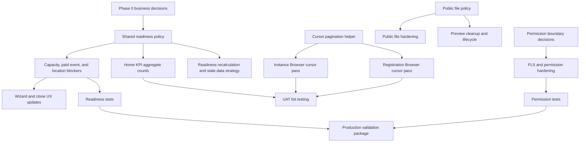

# Summit Events Code Review Implementation Plan - Index

Planning date: 2026-05-18

This folder converts the code review findings into a practical, phase-based implementation backlog. It is intentionally planning-only: do not deploy, do not modify Production, do not modify Summit Events managed package metadata, and do not begin implementation from this document alone.

## Source Review Documents Used

- `docs/CodeReview/01_Executive_Summary.md`
- `docs/CodeReview/02_Technical_Findings.md`
- `docs/CodeReview/03_Failure_Scenarios.md`
- `docs/CodeReview/04_Redundancy_and_Cleanup.md`
- `docs/CodeReview/05_Test_Coverage_Recommendations.md`
- `docs/CodeReview/06_Stakeholder_Facing_Governance_Notes.md`
- `docs/CodeReview/07_Action_Plan.md`

## Files in This Folder

| File | Purpose |
|---|---|
| `01_Backlog_Index.md` | Orientation, dependency map, and recommended implementation order. |
| `02_Prioritized_Backlog.md` | Full backlog table mapped to review finding IDs. |
| `03_Phase_0_Business_Decisions.md` | Business decisions needed before or during implementation. |
| `04_Phase_1_Technical_Fix_Plan.md` | Concrete technical plan for the highest-risk work. |
| `05_Test_Implementation_Backlog.md` | Apex, LWC, Flow, permission, scale, and negative-path test backlog. |
| `06_File_By_File_Implementation_Map.md` | File/component implementation map with proposed changes and test needs. |
| `07_UAT_Readiness_Checklist.md` | Practical UAT checklist for admins, developers, and business owners. |
| `08_Codex_Implementation_Prompts.md` | Staged prompts to run later when implementation is approved. |

## Recommended Implementation Order

1. Phase 0: confirm business rules and permissions.
2. Phase 1: implement shared readiness policy, capacity/paid/location blockers, public file hardening, Instance Browser pagination, Registration Browser pagination, Home KPI aggregate counts, preview cleanup, permission/FLS hardening, and tests.
3. Phase 2: hide placeholders, validate record type/program UX, flow fault handling, and UAT documentation.
4. Phase 3: finish production controls such as export governance, scheduled readiness reconciliation, Visualforce URL validation, and monitoring.
5. Phase 4: refactor large services and components after the high-risk behavior is stable.
6. Phase 5: future data-model and search enhancements.

## Overall Dependency Map

## Do Not Touch

- Do not modify managed package metadata or managed package code.
- Do not deploy anything from this planning pass.
- Do not modify Production without explicit user approval in a future implementation task.
- Do not delete legacy/draft assets until business/admin validation confirms they are unused.
- Do not replace working flows with Apex unless that work is separately approved.
- Do not perform broad rewrites before the Critical/High production risks are addressed.

## First Recommended Implementation Prompt

Run Prompt 1 from `08_Codex_Implementation_Prompts.md`: Phase 0 decision documentation only.

After those decisions are accepted, run Prompt 2: shared readiness policy service.

